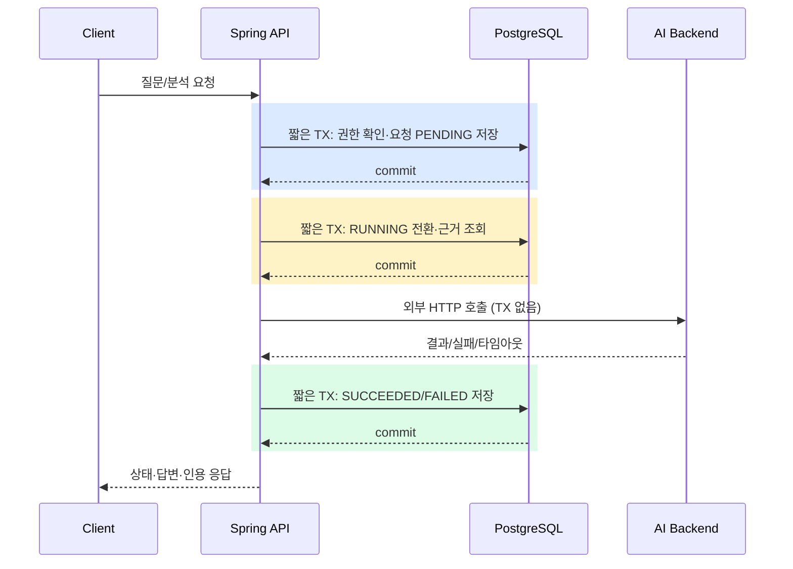
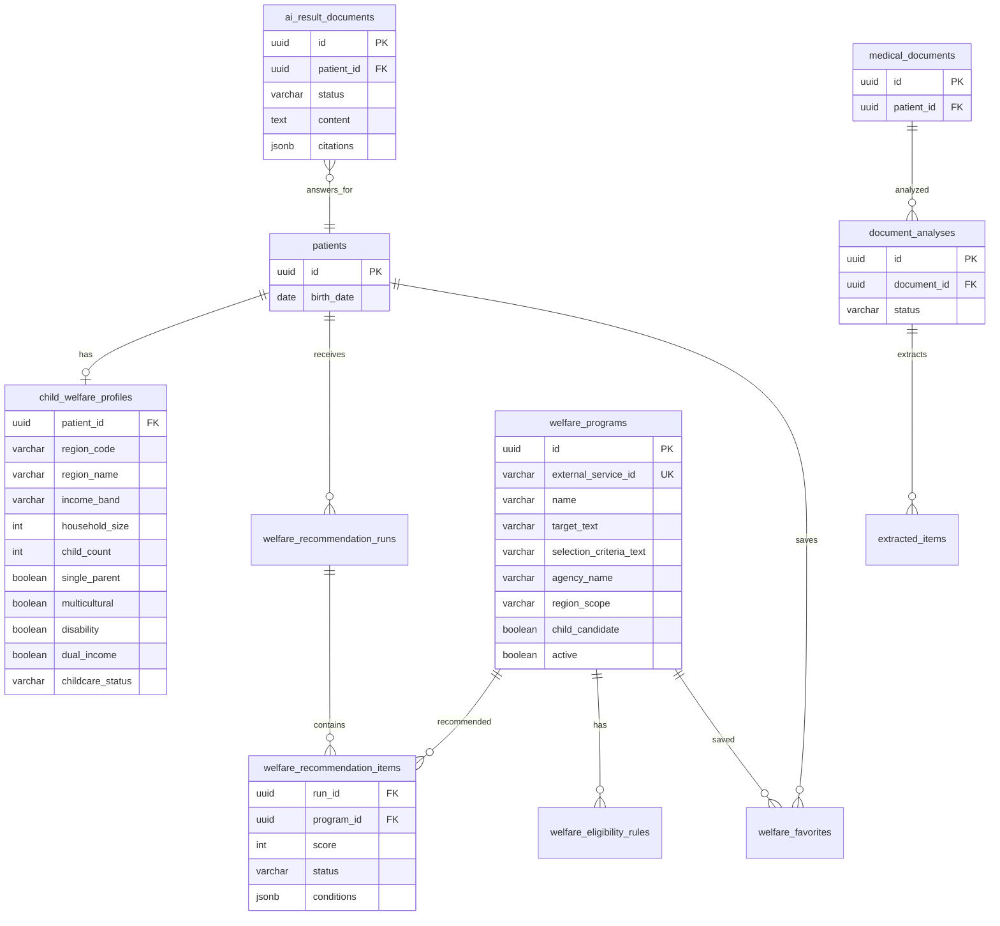

# 복지 프로그램 동기화·추천 전체 흐름

이 문서는 `feat/welfare-recommendation-api` 브랜치의 복지 기능을 커밋 순서와 함께 설명합니다. PR 리뷰에서 데이터 유입부터 API 응답까지 한 번에 추적할 수 있도록 작성했습니다.

## 1. 전체 흐름

```mermaid
flowchart TD
    start([보호자 화면]) --> profile[자녀 맞춤정보 저장]
    profile --> recommend[GET /api/welfare-recommendations]
    gov[정부24 목록 API] --> candidate[후보군 필터링]
    candidate --> catalog[(welfare_programs)]
    catalog --> evaluate[규칙 기반 자격 판정]
    profile --> evaluate
    child[(patients)] --> evaluate
    evaluate --> exclude{제외 규칙}
    exclude -->|지역 밖·연령 밖·특수 자격·가구 게이트| removed[excludedCount]
    exclude -->|통과| score[조건별 점수 계산]
    score --> dedupe[사업명·지역 중복 제거]
    dedupe --> order[점수·지역 구체성·최신 수정일 정렬]
    order --> response[추천 목록·조건별 근거 응답]
    response --> detail[GET /api/welfare-programs/{id}]
    detail --> ai[POST /api/v1/welfare/explanations]

    classDef c1 fill:#dbeafe,stroke:#2563eb,color:#111827
    classDef c2 fill:#dcfce7,stroke:#16a34a,color:#111827
    classDef c3 fill:#fef3c7,stroke:#d97706,color:#111827
    classDef c4 fill:#fce7f3,stroke:#db2777,color:#111827
    class start,profile,response,detail,ai c1
    class gov,candidate,catalog c2
    class evaluate,exclude,score,dedupe,order c3
    class child,removed c4
```

색상은 다음을 뜻합니다.

- 파랑: 사용자/API 흐름
- 초록: 정부24 수집·카탈로그 저장
- 노랑: 규칙 기반 추천 엔진
- 분홍: 자녀 데이터 또는 제외 결과

## 2. 커밋별 흐름 매핑

복지 기능이 처음 시작된 `e31c1d3` 이후의 커밋을 시간순으로 세었습니다. 따라서 아래 번호는 GitHub 화면의 임의 표시 번호가 아니라 이 브랜치의 복지 작업 순번입니다.

| 순번 | 커밋 | 담당 흐름 |
|---:|---|---|
| 1 | `41a55e1` | 정부24 클라이언트 계약·설정 |
| 2 | `cfd4878` | 카탈로그·동기화 DB 스키마 |
| 3 | `00409d0` | 복지 프로그램 영속화 |
| 4 | `3613566` | 정부24 목록/상세 API 호출 |
| 5 | `dce87da` | 정부24 데이터를 아동 복지 후보로 분류하고 카탈로그에 저장 |
| 6 | `036de7a` | 정부24 환경변수 문서화 |
| 7 | `d9f9e11` | 후보군 오탐 감소 |
| 8 | `cd7d62c` | 대상·선정·신청·서류 등 상세 필드 보강 |
| 9 | `ca29bd5` | 저장된 프로그램 검색 API 노출 |
| 10 | `14c0c4b` | 환경 예시 정리 |
| 11~13 | `de361a2`~`c966e70` | 맞춤정보·API 응답·추천 실행 이력 |
| 14 | `46bc38e` | 규칙 기반 점수·조건별 근거 엔진 |
| 15~18 | `5686d3b`~`b19fe6f` | 추천 API·관심 혜택·생성자 주입 안정화 |
| 19~24 | `26ac66e`~`83b86f0` | 실데이터 동기화·Flyway/임베딩 안정화 |
| 25~33 | `e7b2046`~`04e2ce0` | 권한·중복·지역 계층·가구 조건 제외 규칙 |

요청에서 말한 “커밋 5”는 `dce87da`로 확인했습니다. “커밋 9”는 이 순번에서는 검색 API 노출(`ca29bd5`)이며, 규칙 기반 추천 엔진 자체는 실제로 커밋 14인 `46bc38e`에서 구현되었습니다. 번호를 임의로 바꾸지 않고 실제 이력 기준으로 구분했습니다.

## 3. 커밋 5: 후보군을 어떻게 정했는가

### 발견한 문제

정부24에는 아동·가족과 무관한 복지서비스가 함께 존재합니다. 전체 카탈로그를 추천 엔진에 넣으면 성인·기업·사고 피해자·어업·법률 지원 같은 사업이 아동 추천 결과에 섞여 정확도가 떨어집니다.

### 해결 방법

`WelfareSyncService.isChildCandidate`가 서비스명, 지원 목적, 지원 대상, 서비스 분류를 하나의 검색 문자열로 합친 뒤 아동·양육 관련 키워드 중 하나라도 포함하는 경우만 `childCandidate=true`로 저장합니다.

초기 후보 키워드는 다음과 같습니다.

`출산`, `영아`, `유아`, `아동`, `양육`, `보육`, `돌봄`, `교육`

이후 오탐을 줄이기 위해 `d9f9e11`에서 강한 아동 키워드와 보조 키워드를 분리하고, 제외 키워드를 적용했습니다.

- 강한 키워드: `영아`, `유아`, `영유아`, `아동수당`, `부모급여`, `보육료`, `어린이집`, `유치원`, `가정양육`, `아이돌봄`, `출산`, `임신`, `아동복지`, `아동양육`
- 보조 키워드: `양육`, `보육`, `돌봄`, `교육`, `자녀`, `아동`
- 제외 키워드: `성폭력`, `범죄피해`, `피해자`, `국선변호사`, `진술조력`, `해양사고`, `어선`, `옵서버`

실제 판정은 이름·대상·목적의 강한 키워드에 각각 3·3·2점, 분류·이름의 보조 키워드에 각각 1점을 부여하고 합계 3점 이상일 때 통과시키는 방식입니다. 제외 키워드가 하나라도 있으면 점수와 무관하게 탈락합니다. 후보군 필터는 자격 판정이 아니며, 최종 자격은 다음 단계의 `WelfareEligibilityEvaluator`가 수행합니다.

## 4. 규칙 기반 추천 엔진

### 4-1. 제외 규칙

다음은 점수로 보정하지 않고 후보에서 제거합니다.

1. **지역 밖**: 전국 사업은 통과하고, 시·도/시·군·구가 자녀 프로필과 불일치하면 제외합니다.
2. **연령 밖**: 대상 연령 범위를 파싱해 자녀의 월령이 범위를 벗어나면 제외합니다.
3. **특수 자격**: 북한이탈·입양·가정위탁·난민 등 프로필로 확인할 수 없는 특수 자격이 사업명에 명시되면 제외합니다.
4. **가구 게이트**: 장애·한부모·다문화·다자녀 사업인데 해당 프로필 값이 `true`가 아니면 제외합니다.
5. **추천 최소 점수**: 제외 규칙을 통과해도 점수가 30점 미만이면 노출하지 않습니다.

### 4-2. 점수 규칙

사업이 요구하는 조건에 대해서만 가중치를 합산합니다.

| 조건 | 가중치 |
|---|---:|
| 지역 | 30 |
| 연령 | 25 |
| 소득 | 18 |
| 가구 | 12 |
| 양육 형태 | 10 |
| 맞벌이 | 8 |

- 충족(`MET`): 가중치 100% 반영
- 미충족(`UNMET`): 제외 규칙 대상이 아니면 0점
- 확인 필요(`UNKNOWN`): 가중치의 40%만 반영
- 점수 75점 이상이고 지역·연령이 확정 충족이면 `ELIGIBLE`, 그 외는 `POSSIBLE`

소득 키워드는 일반적인 “수급” 단어만으로 판정하지 않습니다. 상세 설명에 포함된 지급정지·행정번호 문구가 소득심사로 오인되지 않도록 다음처럼 명시적인 표현을 사용합니다.

`기초생활수급자`, `기초생활수급 가구`, `차상위계층`, `차상위 가구`, `생계급여 수급자`, `의료급여 수급자`, `주거급여 수급자`, `교육급여 수급자`, `소득인정액`

중위소득은 `기준중위소득 N%` 패턴을 찾아 가장 넓은 기준을 사용합니다.

### 4-3. 정렬·중복 제거

`점수 내림차순 → 지역 구체성(시·군·구 > 시·도 > 전국) → 원천 수정일 최신순 → 사업명순`으로 정렬합니다. 동일 사업명·동일 지역은 가장 높은 후보 하나만 남기고 최대 50건을 반환합니다.

## 5. AI 호출과 커넥션 풀

AI 외부 호출 중 DB 커넥션을 점유하지 않도록 다음 순서로 분리되어 있습니다.



`AiResultDocumentCommandService.create`와 `AiChatCommandService.ask`는 `Propagation.NEVER`로 호출되어 기존 트랜잭션이 있으면 즉시 실패하고, 각 DB 작업은 `TransactionTemplate`로 짧게 실행됩니다. 따라서 AI 응답 대기 시간(`AI_RESULT_READ_TIMEOUT=330s`) 동안 Hikari 커넥션을 붙잡지 않습니다. 문서 업로드도 원본 파일 저장과 AI 요청을 DB 트랜잭션에서 분리합니다.

## 6. 관련 ERD

복지 추천과 AI 설명에 직접 연결되는 테이블만 표시합니다.



## 7. 환경 변수 검토

`.env.example`에는 실 secret을 넣지 않고 다음 연결에 필요한 키와 기본 타임아웃을 모두 표시했습니다.

- 정부24: `GOV24_WELFARE_*`
- AI 연결: `AI_BASE_URL`, `AI_INTERNAL_TOKEN`
- AI 네트워크/재시도: `AI_CONNECT_TIMEOUT`, `AI_READ_TIMEOUT`, `AI_RESULT_READ_TIMEOUT`, `AI_MAX_ATTEMPTS`, `AI_RETRY_BACKOFF`
- 파서 버전: `AI_PARSER_VERSION`

실제 키·토큰은 `.env`에만 넣고 커밋하지 않습니다.
